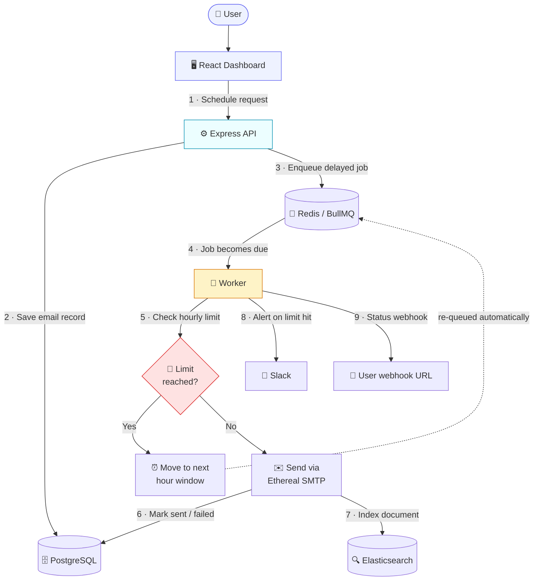

# ReachInbox — Email Scheduler & Dashboard

A production-grade email scheduling service: accept send requests via API, schedule them with **BullMQ delayed jobs on Redis**, persist everything in **PostgreSQL**, send through **Ethereal Email (fake SMTP)**, index emails in **Elasticsearch** for search, and serve a **React dashboard** with Google login, compose, scheduled/sent views and Slack rate-limit alerts.

## Architecture

```
┌──────────────┐   schedule request    ┌──────────────────┐
│ React        │ ────────────────────► │  Express API     │
│ Dashboard    │                       │  (port 4000)     │
└──────────────┘                       └────────┬─────────┘
                                                │
                     ┌──────────────────────────┼───────────────────────┐
                     ▼                          ▼                       ▼
            ┌─────────────────┐      ┌───────────────────┐     ┌──────────────────┐
            │  PostgreSQL     │      │  Redis / BullMQ   │     │ Elasticsearch    │
            │  (Prisma)       │      │  delayed jobs +   │     │ (search index)   │
            │                 │      │  hourly counters  │     │                  │
            └─────────────────┘      └─────────┬─────────┘     └──────────────────┘
                                               │ job becomes due
                                               ▼
                                      ┌─────────────────┐
                                      │  BullMQ Worker  │
                                      │  concurrency +  │
                                      │  min-delay      │
                                      └────────┬────────┘
                                               │
                          ┌────────────────────┼─────────────────────┐
                          ▼                    ▼                     ▼
                 ┌────────────────┐   ┌──────────────────┐   ┌─────────────────┐
                 │ Ethereal SMTP  │   │ Slack notify     │   │ Status webhook  │
                 │ (nodemailer)   │   │ (rate-limit hit) │   │ (sent/failed)   │
                 └────────────────┘   └──────────────────┘   └─────────────────┘

   Bull Board live queue UI: http://localhost:4000/admin/queues
```





---

## 🌍 Live Project

Experience the deployed ReachInbox application directly:

<p align="center">
  <a href="https://reachinbox-app-v1vg.onrender.com/" target="_blank">
    
  </a>
</p>

**Project Status:** Deployed on Render.

> Explore the live application to experience its email scheduling and automation capabilities.
---

## Repo layout

```
backend/    Express + TypeScript API, BullMQ worker, Prisma, services

frontend/   Vite + React + TypeScript + Tailwind dashboard
docker-compose.yml   Redis + Postgres + Elasticsearch
```

## Quick start

### 1. Infra

```bash
docker compose up -d     # redis:6379, postgres:5432, elasticsearch:9200
```

### 2. Backend

```bash
cd backend
cp .env.example .env     # fill in values (see below)
npm install
npx prisma migrate dev   # creates tables
npm run dev              # API on :4000
# second terminal:
npm run worker           # BullMQ worker
```

Bull Board live queue UI: `http://localhost:4000/admin/queues` (basic auth `BULL_BOARD_USER`/`BULL_BOARD_PASSWORD`).

### 3. Frontend

```bash
cd frontend
npm install
npm run dev              # http://localhost:5173 (proxies /api -> :4000)
```

### 4. Env vars (backend/.env)

| Var | Purpose |
|---|---|
| `DATABASE_URL` | Postgres connection |
| `REDIS_URL` | BullMQ / rate-limit counters |
| `ELASTICSEARCH_URL`, `ES_INDEX` | Search backend |
| `WORKER_CONCURRENCY` | Parallel job processing (default 10) |
| `MIN_DELAY_BETWEEN_SENDS_MS` | Min spacing between sends — we chose **2000 ms** |
| `MAX_EMAILS_PER_HOUR_PER_SENDER` | Global fallback hourly cap (default 100) |
| `ETHEREAL_USER` / `ETHEREAL_PASS` | SMTP creds from https://ethereal.email — if empty, a throwaway Ethereal account is created at boot and creds printed to the worker log |
| `GOOGLE_CLIENT_ID` / `GOOGLE_CLIENT_SECRET` / `GOOGLE_REDIRECT_URI` | Google OAuth — redirect URI must be `<API>/api/auth/google/callback` |
| `SLACK_CLIENT_ID` / `SLACK_CLIENT_SECRET` / `SLACK_REDIRECT_URI` / `SLACK_NOTIFY_CHANNEL_ID` | Slack OAuth v2 — needs `chat:write`, `channels:read`, `groups:read`, `im:write`, `mpim:write` bot scopes |
| `ALLOW_DEV_LOGIN` | `true` enables a dev-only email login on the sign-in page (local testing without Google creds) |

## Features

**Backend**
- Schedule emails via API (`POST /api/emails/schedule`, bulk recipients, per-recipient staggered `scheduledAt`)
- BullMQ delayed-job scheduling — no cron; survives restarts (Redis persistence + boot reconciliation)
- Idempotent sends (jobId dedupe + DB status guard)
- Worker concurrency + BullMQ limiter for min inter-send delay
- Redis-backed per-sender hourly rate limit; overflow auto-rescheduled to next hour window
- Slack OAuth + live `chat.postMessage` notification on rate-limit hit (no-op when not connected)
- Elasticsearch indexing & search API
- Bull Board queue dashboard
- Ethereal SMTP sending via nodemailer (auto test account if no creds)


- **Email templates** — per-user reusable subject/body (`/api/templates` CRUD, picker + "save as template" in compose)
- **Attachments** — up to 5 files / 8 MB total per email, stored under `backend/uploads/` and attached via nodemailer
- **Open/click tracking** — every email gets a per-recipient tracking token; HTML includes a 1×1 open pixel (`/api/track/o/:token.gif`) and links are the rewritten through `/api/track/c/:token?u=…` redirects. `openedAt`/`clickedAt` are recorded on the email and shown in the dashboard
- **Status webhooks** — users can set a webhook URL (`PUT /api/auth/webhook` or the compose modal); the backend POSTs `{event: "email.sent"|"email.failed", …}` JSON on terminal status changes


**Frontend**
- Real Google OAuth login, header with name/email/avatar, logout
- Scheduled / Sent tabs with loading + empty states, live polling
- Compose modal: template picker + save-as-template, CSV/TXT lead upload with detected-count, attachments (max 5 / 8 MB), subject, body, start time, delay, hourly limit, status webhook URL
- Open/click badges on sent emails; attachments stored in `backend/uploads/` (gitignored)
- Elasticsearch-backed search across emails
- Slack connect/disconnect + notification channel picker


- **Cancel/delete** — per-row cancel for pending emails (removes the BullMQ job) and delete for sent/failed, plus "Clear sent" bulk delete; ES docs removed too


- **Stats endpoint** — `GET /api/emails/stats` (per-status counts, sent-last-24h, hourly Redis counter usage)


- **Hourly usage bar** in the header showing `used/limit` for the current window


- **i18n** — English / Español / हिन्दी switcher (header + login), persisted in localStorage

- **Dark mode** toggle (persisted)

- **CSV export** of the current tab's list

- **Failed-send toasts** — the 5s poll diff surfaces new failures without opening the table

## Run everything in Docker (optional)

Infra only (default): `docker compose up -d`

Full stack including API, worker and frontend:

```bash
docker compose --profile app up -d --build
# dashboard -> http://localhost:8080  (nginx serves frontend + proxies /api)
# api      -> http://localhost:4000   (Bull Board: /admin/queues)
```

Backend and frontend each have a `Dockerfile`; the backend image runs `prisma migrate deploy` on boot. The worker uses the same image with `node dist/worker.js`.

## Demo script (5 min)

1. `docker compose up -d`, `cd backend && npm run dev` + `npm run worker`, `cd frontend && npm run dev`
2. Open http://localhost:5173 → dev-login (or Google) → dashboard
3. **Compose**: upload a CSV of ~10 emails, subject/body, start time = now+1min, delay 3s, hourly limit e.g. 5 → Schedule
4. Watch **Scheduled → Sent** tabs update live; open Bull Board (`/admin/queues`) to see delayed/active/completed jobs
5. **Restart test**: schedule another email 2 min out → kill the worker (`Ctrl+C`) → restart `npm run worker` → email still sends on time
6. **Rate limit**: schedule 10 emails with hourly limit 3 → first 3 send, rest show `rate limited` and resume next hour window
7. **Tracking**: open a sent email's Ethereal preview (link in worker logs) or hit `/api/track/o/<token>.gif` → "opened" badge appears
8. **Extras**: switch language (EN/ES/HI), toggle dark mode, export CSV, set a webhook URL and watch it receive `email.sent`

Postman collection: `docs/postman/ReachInbox.postman_collection.json`


## Assumptions & trade-offs

- **Rate-limit keying**: counters are per *user* (tenant); each compose batch can carry its own `hourlyLimit`, and the shared counter is conservative when batches differ.

- **Ordering**: jobs delayed into the next hour window keep approximate FIFO order; exact ordering under limit overflow is best-effort.

- **Duplicate-send window**: a crash between SMTP success and the DB `sent` update could resend once; the window is sub-second and BullMQ stalled-job recovery covers worker crashes.

- **Ethereal `from` address**: Ethereal accepts arbitrary `From` headers in practice; for real SMTP you'd verify sender domains.

- **Dev login**: `ALLOW_DEV_LOGIN=true` exists only for local demos without Google OAuth configured; it is disabled by default.

- **Search scope**: ES queries are filtered to the logged-in user.


---

## Deploy to Render (hosted link)

`render.yaml` is a Blueprint — Render Dashboard → **New → Blueprint** → connect this repo and it provisions everything:

| Service | Type | URL |
|---|---|---|
| `reachinbox-app` | Web — API + BullMQ worker + built frontend, single origin (`dist/all.js`) | `https://reachinbox-app.onrender.com` |
| `reachinbox-redis` | Key Value (BullMQ + rate counters) | internal |
| `reachinbox-db` | PostgreSQL | internal |

The API and worker share one process on the free tier (Render doesn't offer background workers on free plans); BullMQ stalled-job recovery covers restarts. For scale, split into a paid Background Worker running `node dist/worker.js`.

After first deploy, fill the `sync: false` env vars in each service: `ELASTICSEARCH_URL` (free deployment at cloud.elastic.co), `GOOGLE_CLIENT_ID/SECRET` (update redirect URI to `https://reachinbox-app.onrender.com/api/auth/google/callback` in Google Cloud), `SLACK_*` (redirect URI `https://reachinbox-app.onrender.com/api/slack/callback`), `BULL_BOARD_USER/PASSWORD`.

Notes: free Render web services sleep after ~15 min idle; free Postgres expires after 30 days; BullMQ needs Redis `noeviction` (set in blueprint). For a persistent demo consider paid plans.

---
---

> **Built for ReachInbox** — because at ReachInbox, reliable scheduling and sending of emails at scale isn't just a feature, it's the foundation everything else stands on. This project is a tiny slice of that system: persistent BullMQ jobs on Redis, a single source of truth in Postgres, safe rate limiting, real OAuth, live search — production patterns, zero cron, zero dropped emails.

⭐ **See it in action** — clone it, run `docker compose up -d`, hit *Compose New Email*, and watch thousands of jobs schedule, throttle and send themselves — surviving restarts, respecting rate limits, and reporting every status back to you. Sometimes the best code is the kind you never have to think about. 🚀
