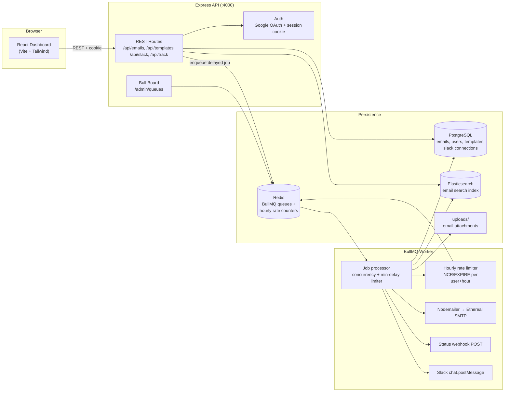

# ReachInbox — System Architecture

## High-level diagram



## Components

### Frontend (`frontend/`)

- **Vite + React + TypeScript + Tailwind** single-page app.
- Pages/components: `Login` (Google OAuth + dev login), `Header` (user info, Slack connect, language switcher, dark mode, hourly usage bar), `Dashboard` (Scheduled/Sent tabs, search, CSV export, toasts), `ComposeModal` (leads upload, templates, attachments, webhook URL), `EmailTable`, `Toast`.
- i18n via a lightweight `LanguageProvider` with dictionaries (en/es/hi/kn); theme via a `theme.ts` helper persisted in `localStorage`.
- Polls `/api/emails/scheduled|sent` every 5 s; diffs failures to raise toasts.

### API (`backend/src/index.ts` + `routes/`)

- Express app; `requireAuth` middleware on all `/api/*` except health, tracking pixels/redirects and OAuth callbacks.
- `routes/emails.ts` — schedule, list, stats, search proxy, delete/cancel, parse-leads, bulk delete.
- `routes/auth.ts` — Google OAuth flow, dev login, `/me`, webhook URL.
- `routes/templates.ts`, `routes/slack.ts`, `routes/track.ts` — templates CRUD, Slack OAuth/channels, open-pixel + click redirect.
- Bull Board mounted at `/admin/queues` (basic auth).

### Worker (`backend/src/worker.ts`)

- BullMQ `Worker` on queue `email-sends` with configurable `concurrency` and a `limiter` enforcing `MIN_DELAY_BETWEEN_SENDS_MS` between job starts.
- On boot: `reconcileScheduledEmails()` re-creates BullMQ jobs for DB rows still pending (crash/Redis-flush recovery).
- Processor flow per job: load email → skip if already terminal (idempotency) → check hourly counter → send via nodemailer/Ethereal → update DB (`sent`/`failed`, `sentAt`) → index ES → fire webhook → maybe Slack alert.

### Data stores

| Store | Holds |
|---|---|
| PostgreSQL (Prisma) | `User`, `Email`, `Template`, `SlackConnection` — source of truth for email state |
| Redis | BullMQ delayed/active/completed jobs; `hourly:<userId>:<window>` counters |
| Elasticsearch | Denormalized email docs for full-text search |
| `backend/uploads/` | Attachment binaries (referenced by path in DB) |

## Key flows

### Scheduling

```
POST /api/emails/schedule
  → validate recipients/subject/body/startAt
  → for each recipient:
      INSERT Email(status=scheduled, scheduledAt = startAt + i*delay)
      queue.add("send", {emailId}, {jobId: "email-<id>", delay})
  → index each in ES
```

### Sending (worker)

```
job picked up (BullMQ limiter spaces starts by MIN_DELAY)
  → load Email; if status != scheduled/rate_limited → skip (idempotent)
  → INCR hourly:<user>:<window>; if > limit:
        moveToDelayed(nextHourStart) + throw DelayedError
        → notify Slack (once per window)
  → nodemailer.sendMail (Ethereal, with attachments if any)
  → UPDATE Email SET status=sent, sentAt=now
  → ES re-index; POST user webhook {event:"email.sent"}
  on error → status=failed, failReason; webhook {event:"email.failed"}
```

### Restart recovery

- BullMQ persists delayed jobs in Redis → future sends survive restarts untouched.
- If Redis lost jobs but Postgres kept `scheduled` rows → boot reconciliation recreates them.
- DB status guard ensures a re-run job can't double-send.

### Rate limiting detail

- Counter key: `hourly:<userId>:<floor(now/hour)>` with `EXPIRE` ≈ 2 h — shared across all worker instances, no in-memory state.
- Overflow → `job.moveToDelayed(nextHourStart, token)` + `DelayedError` → BullMQ re-queues automatically at the next window. Nothing is dropped or marked failed.

## Failure & edge-case handling

| Scenario | Behavior |
|---|---|
| Worker crash mid-send | BullMQ stalled-job recovery re-runs it; DB guard prevents duplicates after `sent` |
| SMTP failure | `status=failed` + `failReason`, webhook fired, ES updated |
| Redis flush | Boot reconciliation rebuilds missing jobs from Postgres |
| Rate-limit overflow | Job delayed to next hour; Slack notified once per window |
| Webhook down | Logged & swallowed — never fails the email |
| Cancel/delete pending | BullMQ job removed + DB row deleted + ES doc removed |
